# Zenvork backend interview playbook

> **Goal:** explain the backend you have actually built in Zenvork with confidence—not as a list of
> definitions, but as a working multi-tenant SaaS system built with Node.js, Express, MongoDB, and
> Mongoose.

This guide focuses on reusable backend patterns. The names will change from company to company, but
the reasoning behind authentication, authorization, validation, schemas, transactions, queries,
indexes, and reporting is broadly applicable.

---

## 1. The 60-second project explanation

> “Zenvork is a multi-tenant B2B booking and business-management SaaS. Each business is a tenant.
> Owners and staff authenticate, while clients are tenant-owned records and do not log in. The backend
> is Node.js with Express, MongoDB through Mongoose, cookie-based authentication, role and scope-based
> authorization, booking lifecycle rules, resource assignment, dashboard reporting, reminders, and a
> controlled AI-assistant module. The key design rule is that every tenant-owned database operation
> derives `businessId` from the authenticated session rather than trusting a value sent by the browser.”

If the interviewer asks for more detail, use the rest of this document as your map.

---

## 2. The complete request journey

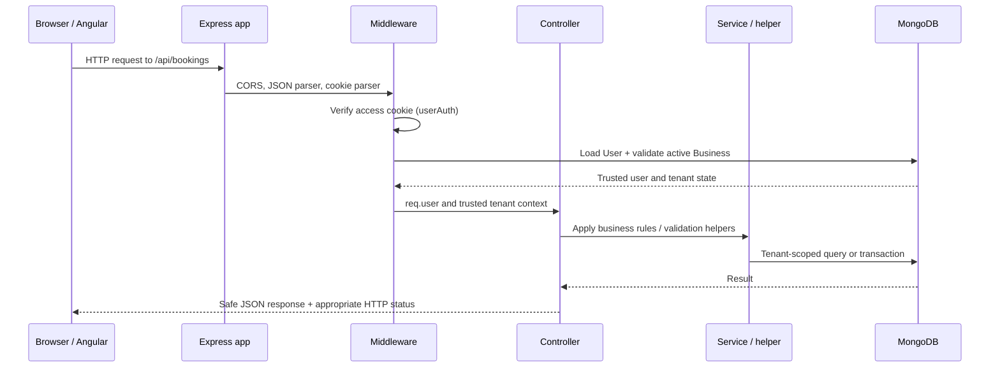

### The important lesson

The browser can send a request, but it is **not trusted**. The backend must decide:

1. Who is making the request? — authentication.
2. Is that account still allowed? — account/business lifecycle check.
3. Is that role allowed to do this? — authorization.
4. Which tenant may it access? — server-derived `businessId`.
5. Is the input valid? — request validation.
6. Does it make business sense right now? — business/lifecycle rules.
7. What safe data should be returned? — response shaping.

---

## 3. Zenvork backend map

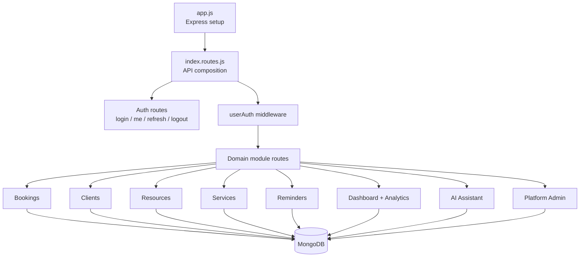

| Layer | Zenvork example | Why it exists |
|---|---|---|
| Configuration | `config/environment.js`, `config/db.js` | Read deployment configuration and connect MongoDB. |
| App setup | `app.js` | CORS, JSON parsing, cookies, API mounting, health endpoint. |
| Routes | `routes/index.routes.js`, module `*.routes.js` | Map HTTP method/path to middleware and controller. |
| Middleware | `auth.middleware.js`, `authorize.middleware.js` | Reusable request checks before controllers run. |
| Controller | `booking.controller.js` | Coordinates request validation, business rules, persistence, response. |
| Service/helper | `booking-access.service.js`, analytics services | Reuse non-HTTP domain logic. |
| Model | `booking.model.js`, `user.model.js` | Define MongoDB document shape, indexes, hooks, methods. |
| Validation | module `*.validation.js` | Reject invalid browser input before it reaches write logic. |

---

## 4. Node.js: what matters in practical backend work

### Node.js is event-driven, not “single request at a time”

Node.js runs JavaScript on an event loop. Database and network work is asynchronous, so Node can start
another request while it waits for MongoDB.

```js
const booking = await Booking.findById(id);
```

`await` pauses **this async function**, not the whole server. Other requests can still be handled.

### Interview answer

> “Node works well for I/O-heavy APIs because it does not block the JavaScript thread while it waits for
> MongoDB or another HTTP service. But CPU-heavy work should be moved to a worker process, queue, or
> separate service, otherwise it blocks the event loop.”

### Zenvork examples

- MongoDB queries use `await` in controllers.
- Dashboard independent queries can run in parallel with `Promise.all`.
- Assistant provider calls are asynchronous and bounded by error/timeout handling.
- A future queue/token or scheduled-cleanup feature should use workers/Redis/BullMQ rather than blocking
  a request handler.

---

## 5. Express: routing, middleware, and controllers

### Route composition

`app.js` mounts the full API below `/api`:

```js
app.use('/api', apiRouter);
```

`routes/index.routes.js` mounts public auth routes first, then applies `userAuth` before protected
module routers:

```text
/api/login                  → public
/api/me                     → userAuth → session controller
/api/bookings/*             → userAuth → booking router/controller
/api/analytics/*            → userAuth → authorize('OWNER') → controller
```

### Middleware order matters

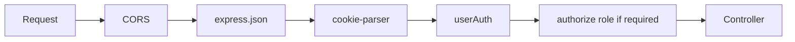

- `express.json()` parses JSON request bodies.
- `cookie-parser` makes cookie values available as `req.cookies`.
- `userAuth` validates the access token and loads the real user.
- `authorize('OWNER')` checks role after identity is trusted.
- The controller should not repeat generic authentication work.

### Controller responsibility

A controller is an orchestrator. A good controller should:

```text
read trusted request data
→ validate input
→ apply business rules
→ call database/service helpers
→ return a safe response
```

It should not become a giant place for unrelated reusable logic. For example, Zenvork keeps booking
access rules in `booking-access.service.js` and reporting aggregation in analytics services.

---

## 6. Authentication versus authorization

These words are often confused.

| Question | Concept | Zenvork implementation |
|---|---|---|
| “Who is this?” | Authentication | `userAuth` verifies the access JWT and loads `User`. |
| “Is this account still active?” | Session/account validation | User active flag, business status, business plan expiry. |
| “May this role use this endpoint?” | Role authorization | `authorize('OWNER')`, `authorize('PLATFORM_ADMIN')`. |
| “May this staff member mutate this booking?” | Fine-grained authorization | Booking access scope: `NONE`, `OWN_AND_UNASSIGNED`, `ALL`. |
| “Which business’s data may they read?” | Tenant authorization | Trusted `businessId` derived from the authenticated user. |

### Cookie session architecture

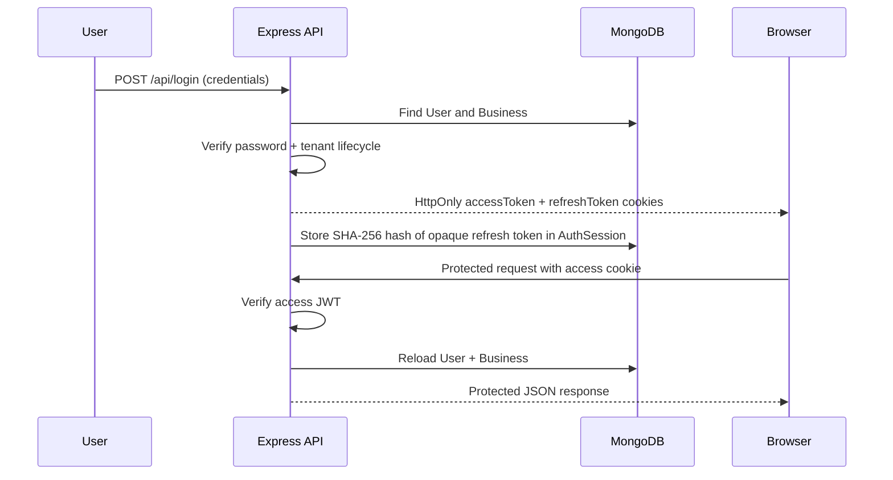

### Why two tokens?

| Token | Format | Lifetime | Purpose |
|---|---|---|---|
| Access token | Signed JWT | Short, for example 15 minutes | Authenticate ordinary API requests. |
| Refresh token | Random opaque value | Longer, for example 30 days of inactivity | Get a new access token without forcing login. |

Zenvork deliberately stores only a SHA-256 hash of the refresh token in `AuthSession`.

```text
Browser cookie has:     raw-refresh-token
Database stores:        SHA-256(raw-refresh-token)
```

If MongoDB data leaked, the stored hash is not usable as a browser token. Refresh rotation replaces the
old hash after every successful refresh; the old raw token fails afterward.

### Refresh flow

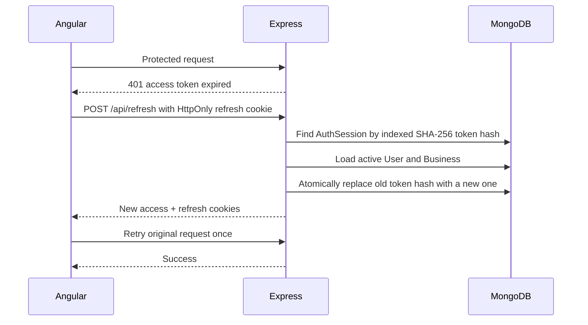

### Strong interview answer

> “I use an HttpOnly cookie so JavaScript cannot read the token. The access JWT is short-lived. The
> refresh token is opaque and server-revocable: the database stores only its hash. On refresh I validate
> the user/business again and atomically rotate the token, then retry the failed request only once on the
> frontend. Logout deletes the session, and password change invalidates all prior refresh sessions.”

### Important security details

- Never put raw passwords or JWTs in JSON responses.
- Use `HttpOnly`, `Secure` in production, and a deliberate `SameSite` policy for cookies.
- CORS must use an explicit allowed origin when `credentials: true` is enabled.
- Reload user/business records on protected requests; a valid old token must not bypass deactivation.
- Do not trust a browser-supplied `userId`, `role`, or `businessId`.

---

## 7. Multi-tenancy: the most important SaaS rule

Zenvork’s tenant is a `Business`.

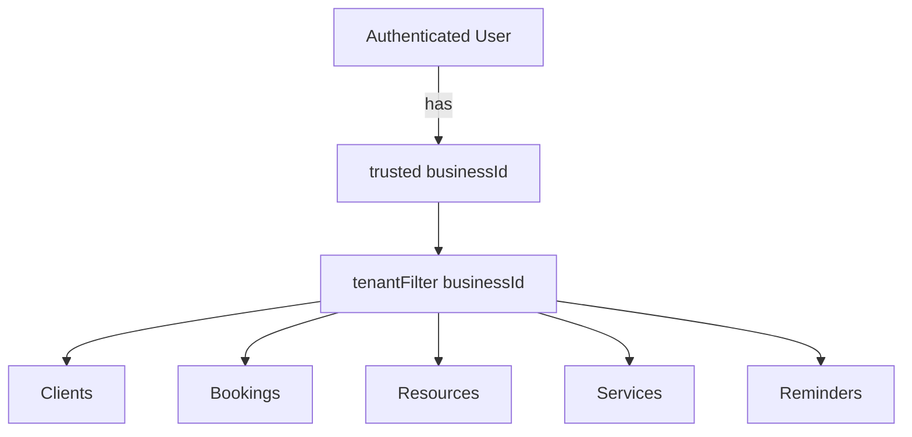

### Unsafe approach

```js
// Dangerous: browser could replace this ID with another business's ID.
Booking.find({ businessId: req.query.businessId });
```

### Correct approach

```js
Booking.find({ businessId: req.user.businessId });
```

Zenvork centralizes this with helpers in `utils/tenant-scope.js`:

| Helper | Meaning |
|---|---|
| `tenantId(req)` | Get the authenticated tenant ID. |
| `tenantFilter(req, criteria)` | Add `businessId` to a read/update/delete filter. |
| `tenantData(req, data)` | Add server-owned `businessId` to a document being created. |

### Why this is better than frontend filtering

Frontend filtering only hides rows after data has already leaked. Tenant scoping in the MongoDB query
means the other tenant’s document is never read, updated, or deleted by that request.

### Interview phrase

> “Tenant isolation is enforced at the data-access boundary, not only in UI routes. I derive tenant
> identity from the verified session and include it in every query filter and create payload.”

---

## 8. Mongoose and MongoDB: models, schemas, hooks, indexes

### Model vocabulary

| Term | Meaning | Zenvork example |
|---|---|---|
| Collection | MongoDB group of documents | `bookings` collection. |
| Document | One JSON-like record | One booking for one client. |
| Schema | Shape + rules for documents | `booking.model.js`. |
| Model | JavaScript interface for collection | `Booking.find(...)`. |
| ObjectId | MongoDB identifier/reference type | `booking.clientId`, `booking.businessId`. |
| Index | Data structure that speeds a lookup/sort | booking calendar and tenant indexes. |
| Hook | Model lifecycle code | Booking status-history initialization; password hashing. |

### Why use Mongoose when MongoDB is flexible?

MongoDB itself allows flexible documents. Mongoose provides a useful application-level contract:

```text
schema field type
→ required/min/max/enum rules
→ default values
→ indexes
→ hooks and instance methods
```

For example:

- `User.password` uses `select: false`, so ordinary queries do not accidentally return password hashes.
- `User` hashes a changed password in a pre-save hook.
- Booking status is restricted to known lifecycle states.
- Booking service snapshots require a positive quantity.
- `timestamps: true` adds `createdAt` and `updatedAt`.

### Validation has layers

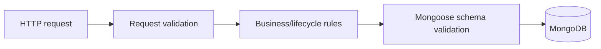

| Layer | Example | Why it exists |
|---|---|---|
| Request validation | `quantity` is a number; ID has valid format | Reject malformed browser input early. |
| Business rule | Cannot check in without required person resource | Depends on current records and lifecycle. |
| Schema rule | `quantity >= 1`, known status enum | Protect data regardless of controller path. |
| Database/index constraint | Unique/indexed identifier patterns | Protect and speed data at persistence level. |

### Indexes: performance is part of backend design

An index is useful when it follows real query shapes, for example:

```text
businessId + status + scheduledStartAt
businessId + resourceId + scheduled time range
businessId + client mobile
tokenHash for refresh-session lookup
```

Do not add indexes blindly: every index increases write/storage cost. Start from the actual `$match`,
sort, and lookup patterns used by your endpoints.

---

## 9. CRUD is not enough: booking as a domain workflow

Many beginner projects treat a booking as simple CRUD. In a production-style system, a booking has
rules, time, money, staff, and lifecycle history.

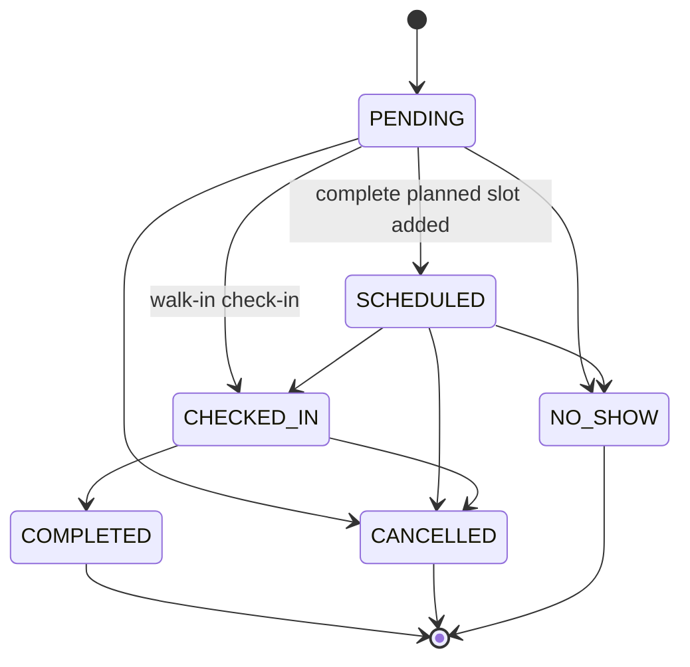

### State-machine thinking

Instead of allowing arbitrary `status = 'COMPLETED'`, define permitted transitions.

```text
PENDING → SCHEDULED → CHECKED_IN → COMPLETED
```

The backend decides the transition is valid and records actual timestamps such as `actualStartAt` and
`actualEndAt` server-side. That is more trustworthy than letting the browser claim when service started
or ended.

### Lifecycle history

Booking `statusHistory` records the transition, actor, and time. This is useful for support,
accountability, analytics, and future audit requirements.

### Actual limitation to state honestly

Zenvork checks planned resource-slot conflicts and checked-in resource conflicts. The deferred backlog
still includes **atomic concurrent active-booking protection**. In an interview, do not claim all
concurrency issues are solved. Say:

> “We validate conflicts today. For a high-concurrency launch, I would make active resource reservation
> fully atomic with a database-enforced reservation or transaction-safe strategy so two simultaneous
> check-ins cannot both observe the resource as free.”

That answer shows mature engineering judgment.

---

## 10. Time, calendars, and overlap queries

### Store instants, display business time

Database dates represent a real instant. API/UI converts that instant for the business timezone when
displaying a calendar day or reporting total.

Why it matters: `2026-10-01T18:45:00Z` may be the next calendar day in India.

### Correct interval-overlap rule

For a booking interval `[start, end)` and requested interval `[requestedStart, requestedEnd)`, they
overlap when:

```js
scheduledStartAt < requestedEnd && scheduledEndAt > requestedStart
```

```mermaid
gantt
    title Interval overlap mental model
    dateFormat  HH:mm
    axisFormat  %H:%M
    Existing booking       :active, 10:00, 90m
    Requested booking      :crit, 11:00, 60m
```

The requested start is before the existing end, and requested end is after the existing start—so they
overlap.

### Multi-day calendar range query

To fetch any booking visible in a calendar range, use the same interval principle:

```js
scheduledStartAt: { $lt: rangeEnd },
scheduledEndAt: { $gt: rangeStart },
```

This includes a booking that started before the current day but continues into it.

### Half-open intervals

Using `[start, end)` means a booking ending exactly at `11:00` does not collide with another beginning
at `11:00`. This avoids false conflicts at adjacent appointment boundaries.

---

## 11. Money, service snapshots, quantity, discount

### Never use floating-point rupees for billing

Store money in the smallest integer unit:

```text
₹650.00 → 65000 paise
```

Why: floating-point values can produce results like `0.1 + 0.2 !== 0.3`.

### Snapshot versus reference

A booking references a service catalogue item, but stores a snapshot of name, price, duration, and
quantity at booking time.

```text
Service catalogue today: Haircut ₹650
Old completed booking:  Haircut ₹500 snapshot
```

If the catalogue price changes, old revenue must remain ₹500. Historical bills should not be rewritten
by future catalogue edits.

### Server-side calculation

```text
service subtotal = Σ(service.pricePaise × service.quantity)
discount         = amount or percentage of service subtotal
total            = max(0, subtotal − discount) + extraAmount
```

The frontend may show an estimate, but the backend recalculates the total from trusted service
snapshots. Never trust a browser-provided “final bill”.

---

## 12. MongoDB query patterns used in real APIs

### Safe read/update/delete

```js
Booking.findOne({ _id: bookingId, businessId: tenantId });
```

Why both fields?

```text
_id only              → can reveal another tenant's booking if ID is known
_id + businessId      → document must belong to authenticated tenant
```

### Pagination

```text
page  = 3
limit = 25
skip  = (page − 1) × limit = 50
```

```js
Booking.find(filter).sort(sort).skip(skip).limit(limit);
```

Also return metadata such as page, limit, total, and total pages so the frontend can render reliable
navigation.

### Search safely

When building a dynamic regex from user text, escape regex metacharacters first. Otherwise a user can
change the meaning of the query with characters such as `*`, `(`, `[`, or `|`.

```js
const escaped = value.replace(/[.*+?^${}()|[\]\\]/g, '\\$&');
```

Then use the escaped search value in a bounded, tenant-scoped query. This is not SQL injection—MongoDB
is different—but it is still input safety and query-correctness work.

### Populate versus aggregation

| Need | Better tool |
|---|---|
| A booking response needs client name/resource label | Mongoose `populate()` or carefully selected lookup. |
| Need totals by day/service/staff | MongoDB aggregation pipeline. |
| Need simple document list/filter | `find()` with a good filter/index. |

---

## 13. Aggregation pipelines: analytics inside MongoDB

Aggregation avoids loading every booking into Node.js just to calculate totals.

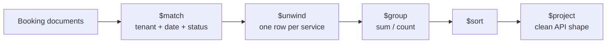

### Example: top service revenue

```js
Booking.aggregate([
  { $match: { businessId, status: 'COMPLETED' } },
  { $unwind: '$services' },
  {
    $group: {
      _id: '$services.serviceId',
      name: { $first: '$services.name' },
      revenuePaise: {
        $sum: {
          $multiply: ['$services.pricePaise', { $ifNull: ['$services.quantity', 1] }],
        },
      },
    },
  },
  { $sort: { revenuePaise: -1 } },
]);
```

Read it as:

```text
match this tenant's completed bookings
→ turn service array into rows
→ group rows by service
→ add price × quantity
→ sort highest revenue first
```

### Business metrics must have meaningful dates

Zenvork distinguishes:

| Metric | Correct date |
|---|---|
| Billed revenue | `actualEndAt`: when work completed. |
| Collected revenue | `paidAt`: when staff marked it paid. |
| Calendar occupancy | scheduled start/end interval. |

This avoids a common reporting bug: calling two different business concepts “revenue” without saying
which date and lifecycle event they use.

---

## 14. Transactions and consistency

A MongoDB transaction groups related writes so they either all succeed or all roll back.

### Zenvork booking creation example

When staff creates a booking and chooses “new client”:

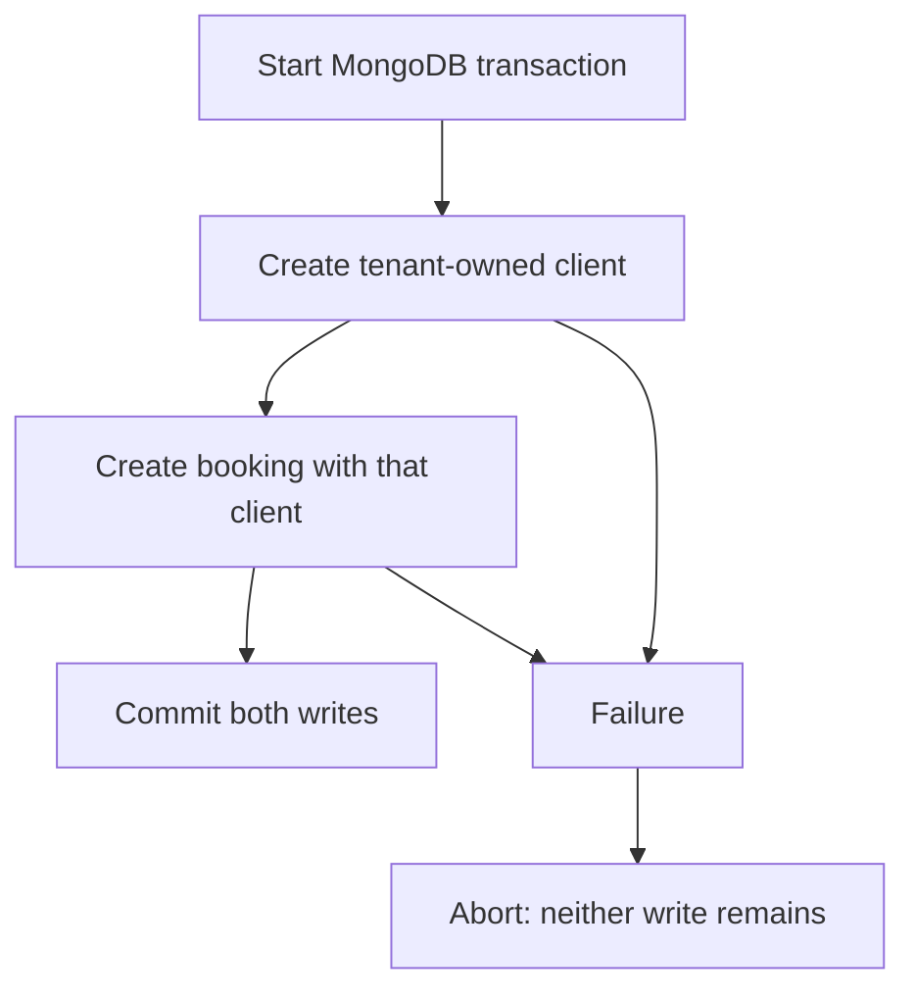

Without a transaction, the client could be created successfully while booking creation fails, leaving
an unwanted partial result.

### When to use a transaction

Use one when several writes must be all-or-nothing:

- create business + owner together;
- create client + booking together;
- a future atomic resource reservation;
- payment ledger entry + booking payment state, if payment ledger is introduced.

Avoid wrapping every ordinary single-document update in a transaction. It adds cost and complexity.

---

## 15. Reminder lifecycle: derived records stay aligned

Zenvork has a reminder record derived from a scheduled booking.

```text
Booking becomes scheduled
→ create or refresh pending reminder

Booking becomes completed/cancelled/no-show
→ pending reminder is no longer actionable

Staff marks reminder sent/called
→ reminder outcome changes
→ booking.updatedAt is not unnecessarily changed
```

This teaches an important backend idea: some records are **derived operational state**, not the source
of truth. The Booking lifecycle remains the source of truth; reminder logic follows it.

---

## 16. AI integration: never give a model unrestricted database access

The Assistant module is intentionally controlled.

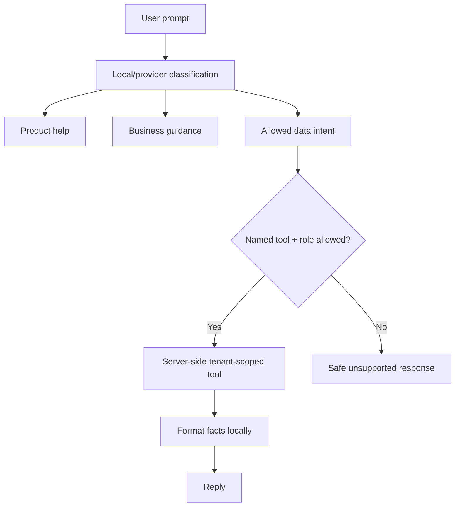

The AI provider does not receive the entire tenant database. For supported questions, server code runs a
specific, tenant-scoped tool such as appointment agenda or revenue summary, then formats the facts
locally. This is a strong answer to: “How would you secure an LLM feature?”

> “I would not let the model construct arbitrary MongoDB queries. I classify intent, allow only a fixed
> tool set, derive tenant/user context server-side, validate role/date inputs, and format trusted tool
> output outside the model.”

---

## 17. Error handling and HTTP status codes

Use status codes intentionally.

| Status | Meaning | Zenvork-style example |
|---|---|---|
| `200` | Successful read/update | Booking fetched; session restored. |
| `201` | Resource created | Client/service/booking created. |
| `400` | Invalid input or invalid business request | Bad date, malformed ID, invalid lifecycle transition. |
| `401` | Not authenticated | Missing/expired/revoked session. |
| `403` | Authenticated but not allowed | Staff hits owner-only endpoint; business unavailable. |
| `404` | Not found in the caller's allowed scope | Booking does not exist for this tenant. |
| `409` | Valid request conflicts with current state | Duplicate resource or future concurrent check-in conflict. |
| `500` | Unexpected server failure | Log safely; do not leak stack/secrets to browser. |

### Good error response

```json
{ "message": "A team member is required before check-in." }
```

The frontend can display this safely. Do not return raw database stack traces, secrets, or internal
query details.

---

## 18. Practical production checklist

Before calling a backend production-ready, think beyond endpoint success.

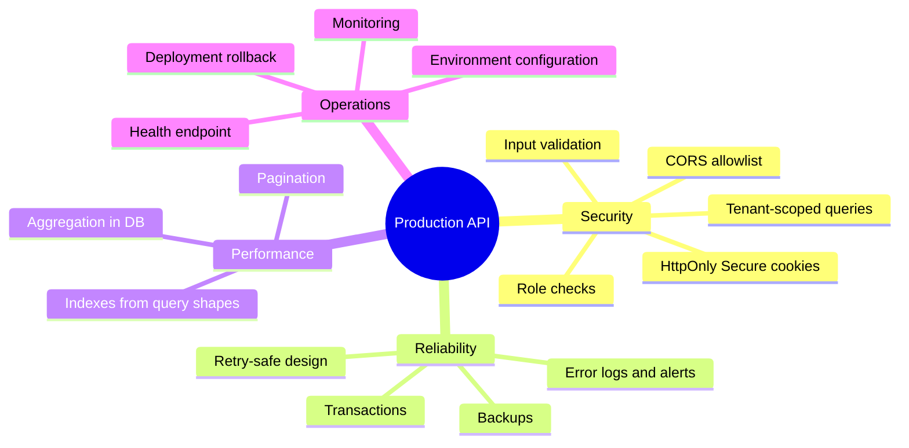

### Present Zenvork honestly

Implemented strengths:

- cookie authentication with rotating, server-revocable refresh sessions;
- tenant isolation helpers and server-derived business identity;
- role and staff-scope authorization;
- Mongoose schemas, hooks, indexes, snapshots;
- booking lifecycle validation and actual timestamps;
- MongoDB transactions for related creation flows;
- aggregation-based dashboard and analytics;
- controlled AI-data tools.

Known next hardening work:

- fully atomic concurrent active-resource check-in protection;
- broader automated backend controller/integration test coverage;
- rate limiting and a formal CSRF strategy if cross-site cookie deployment is used;
- queue/worker infrastructure for token queues and scheduled end-of-day jobs;
- production monitoring, backup, and alerting policy.

Saying this clearly in an interview is much stronger than pretending every production concern is done.

---

## 19. Common interview questions: answers from this project

### “Why use Express middleware?”

> “Middleware centralizes cross-cutting concerns. In Zenvork, authentication validates the cookie and
> loads trusted user/tenant state once before protected controllers run. Role middleware then handles
> reusable role checks. This reduces duplicated, inconsistent security code in controllers.”

### “How do you protect one tenant from another?”

> “I never accept tenant identity as authority from the browser. `businessId` comes from the verified
> user session and is merged into every MongoDB read, update, delete, and create. UI guards improve UX,
> but the database query scope is the real boundary.”

### “Why store price snapshots in bookings?”

> “A service catalogue is mutable but invoices/history are not. A booking stores the selected service's
> price/name/duration/quantity snapshot, so later catalogue changes cannot rewrite historical bills or
> revenue analytics.”

### “When would you use aggregation instead of application code?”

> “For grouped totals such as daily revenue or top services. MongoDB can filter, unwind, group, and sum
> close to the data, which avoids transferring many booking documents to Node only to calculate a few
> totals.”

### “What does a transaction solve?”

> “Atomicity across multiple writes. For example, a new client and their booking should either both be
> created or neither should exist. A transaction prevents half-completed business operations.”

### “How do you handle access-token expiry?”

> “A short-lived JWT access cookie protects normal API calls. On expiry, the frontend makes one refresh
> request using an opaque, database-revocable refresh cookie, rotates it, then retries the original
> request once. If refresh fails, it clears client state and requires login.”

### “What is the difference between validation and authorization?”

> “Validation asks whether input has the required shape and values. Authorization asks whether this
> authenticated user may perform this operation on this tenant's record. Both are required.”

### “How would you scale this?”

> “First measure slow queries and add indexes matching tenant-scoped filters and sorts. Keep list APIs
> paginated, use aggregation for reporting, and move scheduled or expensive work to workers. Add Redis
> for queues, rate limiting, distributed coordination, or hot caching only when profiling shows the
> need—not just because it is popular.”

---

## 20. A focused study order

Do not try to memorize every file first. Follow one request end to end.

### Day 1: HTTP and Express

1. Read `backend/src/app.js`.
2. Read `backend/src/routes/index.routes.js`.
3. Follow one booking route to its controller.
4. Explain middleware order without looking.

### Day 2: Authentication and security

1. Read `auth.middleware.js` and `authorize.middleware.js`.
2. Follow login → `/api/me` → refresh → logout.
3. Explain access token vs refresh token and `HttpOnly` cookies.
4. Read `utils/tenant-scope.js` and explain tenant isolation.

### Day 3: Mongoose and booking domain

1. Read `booking.model.js`.
2. Follow booking creation and update validation.
3. Explain snapshots, paise, status history, and transactions.
4. Draw the booking state machine from memory.

### Day 4: Queries and analytics

1. Read booking list/calendar filters.
2. Explain interval overlap with an example.
3. Read one aggregation pipeline in revenue reporting.
4. Explain `$match`, `$unwind`, `$group`, `$sum`, `$project`.

### Day 5: Think like a reviewer

For every endpoint, ask:

```text
Who can call it?
Which tenant does it operate on?
What input is validated?
What lifecycle rule applies?
Which query/index supports it?
What failures can happen?
What does the client receive?
```

---

## 21. Source map: where to read actual code

| Topic | Start here |
|---|---|
| App startup/CORS/cookies | `backend/src/app.js` |
| API composition | `backend/src/routes/index.routes.js` |
| Authentication | `backend/src/controllers/auth/`, `backend/src/middlewares/auth.middleware.js` |
| Refresh sessions | `backend/src/modules/auth/` |
| Tenant helpers | `backend/src/utils/tenant-scope.js` |
| Booking model/lifecycle | `backend/src/modules/booking/` |
| Resource rules | `backend/src/modules/resource/` |
| Staff roles/scopes | `backend/src/modules/users/` |
| Dashboard/aggregation | `backend/src/modules/dashboard/`, `backend/src/modules/analytics/` |
| Reminder lifecycle | `backend/src/modules/reminder/` |
| Assistant safety/tool calls | `backend/src/modules/assistant/` |

### Related deep-dive guides

- [Express request flow](express-request-flow.md)
- [Authentication](../architecture/authentication.md)
- [Tenant security](tenant-security.md)
- [Booking queries and lifecycle](booking-queries-and-lifecycle.md)
- [MongoDB aggregation](mongodb-aggregation.md)
- [Reminder module](reminder-module.md)
- [AI Assistant module](assistant-module.md)

---

## Final mindset

Backend skill is not “I know `find()`, `await`, and CRUD.” It is being able to explain why a request is
safe, which data is trusted, how failure is handled, what the database guarantees, and where the system
still needs hardening.

If you can walk an interviewer through one Zenvork booking request—from cookie to middleware to tenant
filter to lifecycle rule to MongoDB query to response—you have practical backend experience to discuss.
